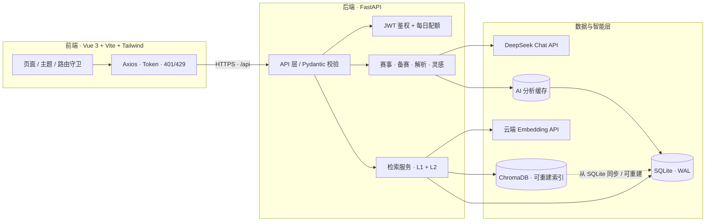

<div align="center">

# KuAo · 库奥

**大学生竞赛 AI 智库**

把散落的赛事信息、获奖作品与备赛经验，变成可检索、可对话、可复用的知识资产。

[](https://vuejs.org/)
[](https://fastapi.tiangolo.com/)
[](https://www.sqlite.org/)
[](https://www.trychroma.com/)
[](https://tailwindcss.com/)
[](https://www.deepseek.com/)
[](#-工程化与质量保证)

[项目简介](#-项目简介) · [核心亮点](#-核心功能亮点) · [技术架构](#-技术栈与架构) · [质量保证](#-工程化与质量保证) · [快速启动](#-快速启动指南) · [项目结构](#-项目结构)

</div>

---

## 🎯 项目简介

**KuAo（库奥）** 是一个面向大学生的竞赛 AI 智库。它不止于“把比赛列出来”，而是围绕真实备赛流程，将 **赛事检索、AI 备考、获奖作品解析与灵感生成** 整合进同一套工作台：

- **找得到**：用自然语言描述需求，系统理解意图并召回最相关的竞赛；
- **备得清**：AI 教练通过多轮对话补齐背景，生成可执行的备赛计划；
- **学得透**：从历年获奖作品中拆解技术亮点、评审偏好与可复用套路；
- **想得出**：按赛事聚合洞察与选题灵感，让“不知道做什么”变成“知道从哪开始”。

| 用户场景 | 常见痛点 | KuAo 的解法 |
| --- | --- | --- |
| 寻找合适竞赛 | 信息分散、筛选成本高、不知道哪些适合自己 | 结构化赛事库 + 自然语言语义检索 |
| 制定备赛计划 | 时间紧、无从下手、计划不可执行 | 多轮对话教练，先追问再生成、可增量修改 |
| 学习获奖作品 | 作品多、看不懂、难以提炼共性 | 单作品深度解析 + 赛事级获奖套路分析 |
| 寻找选题灵感 | 同质化严重、缺少往届参照 | 按赛事隔离的赛事洞察与选题灵感资产 |

> **产品定位**：不是赛事信息聚合页，而是一套面向“检索 → 决策 → 备赛 → 复盘”的 AI 工作流。

---

## ✨ 核心功能亮点

### 01 · AI 智能语义检索

告别“关键词必须完全匹配”的检索方式。用户可以直接输入：

> “我想找寒假能准备的算法赛”
>
> “有没有适合计算机专业、对新手友好的创新创业比赛？”

系统会完成 **查询向量化 → 获奖作品语义召回 → 竞赛级聚合 → 结构化重排**，返回最相关的赛事结果。

- **L1 向量召回**：基于 ChromaDB cosine 相似度进行多路召回；
- **L2 结构化重排**：回到 SQLite 读取作品与竞赛真值，做硬过滤与软加权；
- **竞赛级聚合**：同一赛事的多件命中作品合并计分，避免结果碎片化；
- **优雅降级**：向量库或 Embedding 服务异常时，自动回退关键词检索，页面不白屏。

### 02 · 备赛工作台：多轮对话生成计划

不是“一次性丢给模型一段话”，而是模拟真实教练的渐进式对话：

| 阶段 | 行为 | 返回状态 |
| --- | --- | --- |
| 信息收集 | 背景不足时先反问关键信息 | `ask` |
| 计划生成 | 信息足够后输出完整 Markdown 备赛计划 | `plan` |
| 增量修改 | 在既有计划上继续对话并整合修改 | `refine` |

- 后端自动注入数据库中的真实赛事信息（名称、类别、级别、报名窗口、官网、简介），降低模型编造赛制的概率；
- 支持多轮历史拼接、计划本地恢复与按赛事隔离；
- 输出统一经过 Markdown 安全渲染，兼顾可读性与 XSS 防护。

### 03 · 获奖作品解析：带数据库级缓存

围绕“获奖作品”提供两种分析视角：

- **单作品深度解析**：作品概览、技术亮点、获奖要素、可借鉴之处、潜在不足、模仿路径；
- **赛事共性分析**：横向对比多件获奖作品，提炼选题共性、技术套路、创新模式与“获奖公式”。

更关键的是成本控制：

- 分析结果持久化到 SQLite 的 `ai_analysis_cache`，不是进程内临时缓存；
- 以实际送入模型的 prompt 计算 **SHA-256 指纹**，数据变化时自动失效；
- 同一作品 / 同一赛事再次访问可直接命中缓存，**跳过重复的大模型调用**；
- 缓存读写异常自动降级，不影响主接口可用性。

### 04 · 灵感工作台

围绕具体赛事聚合两类 AI 资产：

- **赛事洞察**：经验（experience）、趋势（trend）、差距（gap）；
- **选题灵感**：标题、一句话 pitch、详细方案、新颖度、风险、难度与参考作品。

灵感数据按 `competition_id` 严格隔离，`evidence` / `ref_awards` 还会做作品归属校验，避免跨赛事“串台”。用户可以收藏感兴趣的灵感，形成自己的选题池。

### 05 · 暗黑模式与多主题切换

内置三套完整主题，覆盖首页、列表、详情、工作台与个人中心：

| 主题 | 视觉语言 |
| --- | --- |
| **官方风** `official` | 校园主题背景 + 半透明遮罩，默认主题 |
| **极简风** `minimal` | 纯白留白，突出内容本身 |
| **科技蓝** `tech` | 深色底 + 蓝色高光，即暗黑模式 |

- 首屏内联脚本在 CSS 加载前写入主题 class，避免 FOUC 闪白；
- 主题选择持久化到 `localStorage`，隐私模式下静默降级；
- 同步 `color-scheme`，让滚动条、输入框等原生控件跟随主题；
- 动效适配 `prefers-reduced-motion`，对减少动态效果的用户友好。

### 06 · JWT 用户鉴权与 AI 额度防刷

- **JWT Bearer 鉴权**：PyJWT 签发与校验，未登录、过期、伪造、用户已删除统一返回 `401`；
- **密码安全**：bcrypt 加盐哈希，不存储明文密码；
- **JWT 启动强校验**：默认开发密钥或长度不足 32 位时，服务直接拒绝启动；
- **AI 每日配额**：按登录用户维度计数，AI 生成类接口统一挂载配额依赖，超额返回 `429` 与 `Retry-After`；
- **登录态边界**：`401` 后清理本地凭证与用户本地数据，避免共享设备上读到上一账号的计划与收藏；
- **前端安全渲染**：Markdown 统一走 `marked → DOMPurify.sanitize`，净化后再交给 `v-html`。

---

## 🛠️ 技术栈与架构

### 技术栈

| 层级 | 技术 | 职责 |
| --- | --- | --- |
| **前端** | Vue 3（Composition API） | 页面与交互状态管理 |
| | Vite 5 | 开发服务器、构建、`/api` 代理 |
| | Tailwind CSS 3.4 | 原子化样式、三套主题与暗黑变体 |
| | Vue Router 4 | 路由、鉴权守卫、懒加载 |
| | Axios | 请求封装、Token 注入、401/429 统一处理 |
| | marked + DOMPurify | Markdown 渲染与 XSS 清洗 |
| **后端** | FastAPI + Uvicorn | REST API、依赖注入、OpenAPI 文档 |
| | Pydantic 2 | 请求/响应模型与边界校验 |
| | SQLite（WAL） | 业务真值库、用户、配额、分析缓存 |
| | PyJWT + bcrypt | 用户鉴权与密码哈希 |
| **AI / 检索** | DeepSeek Chat API | 备赛计划、作品解析、洞察生成 |
| | ChromaDB | 获奖作品向量索引与 cosine 召回 |
| | 云端 Embedding API | 文本向量化，默认模型 `bge-m3`，可配置切换 |
| | JSON Repair | 大模型 JSON 输出的容错修复 |

### 整体架构



### 关键架构决策

#### 1. 为轻量云服务器而生的云端 Embedding

> [!IMPORTANT]
> 项目已移除本地重型 Embedding 模型（`sentence-transformers` / 本地 BGE 权重）的加载路径，改为调用 **OpenAI 兼容的云端 Embedding API**。这不是简单的依赖替换，而是面向轻量级云服务器的关键部署取舍。

| 维度 | 本地 Embedding 方案 | 当前云端 API 方案 |
| --- | --- | --- |
| 常驻内存 | 需加载模型权重与推理运行时 | 仅保留业务进程、SQLite 与 Chroma 索引 |
| 冷启动 | 启动时加载模型，耗时较长 | 懒加载 HTTP 客户端，启动轻快 |
| 依赖体积 | 需要 PyTorch / Transformers 等重依赖 | 仅需 `openai` 兼容客户端 |
| 弹性扩容 | 受单机 CPU / 内存限制 | 向量化能力随 API 弹性扩展 |
| 运维成本 | 需维护模型文件与推理环境 | 只需管理密钥、网络与限流 |

**带来的直接收益：**

- 极大降低后端**常驻内存占用**，避免了本地模型权重带来的数百 MB 级内存压力；
- 显著缩小依赖与镜像体积，更适合 **1C2G / 2C4G** 级别的轻量云服务器；
- 把“重推理”交给云端，把“轻服务”留在本机，部署边界更清晰。

**工程上的配套处理：**

- `embedder.py` 保持 `encode_docs` / `encode_query` / `dim` / `self_test` 接口不变，检索层无感切换；
- 批量分批（默认 32 条/批）、L2 归一化、指数退避重试，兼容 429 / 5xx / 网络抖动；
- Embedding 调用失败**不会静默写入 mock 向量**，避免污染真实索引；仅显式设置 `KB_EMBED_MODE=mock` 时用于离线调试。

#### 2. SQLite 是真值源，ChromaDB 只是可重建索引

- 所有赛事、作品、用户、配额、缓存以 SQLite 为准；
- Chroma 中的 `award:{id}` 向量与 metadata 可从 SQLite 全量重建；
- 检索采用 **L1 向量召回 + L2 SQLite 结构化重排**，命中结果若已删除或未审核会被丢弃；
- 即使向量索引损坏，也不会影响业务数据正确性。

#### 3. 数据库级 AI 缓存，控制推理成本

- 以 `(target_type, target_id)` 定位缓存对象；
- 以 prompt 的 SHA-256 指纹判断内容是否仍有效；
- 缓存命中直接返回，缓存异常自动降级，不让“加速手段”变成故障点。

#### 4. SQLite 并发友好配置

- 统一连接入口，所有业务函数通过上下文管理器获取连接；
- 开启 `journal_mode=WAL`，读写不互相阻塞；
- 设置 `busy_timeout=10000`，写锁竞争时等待而非立即报错；
- 正常提交、异常回滚、最终关闭，避免连接泄漏与锁残留。

---

## 🛡️ 工程化与质量保证

> 交付前，前后端分别完成了**全链路 Code Review**，并针对核心业务路径与边界条件设计了可执行的测试用例。审查报告与用例清单与代码同仓维护，作为持续回归资产。

### 全链路 Code Review

| 范围 | 审查重点 | 交付文档 |
| --- | --- | --- |
| **后端** | 鉴权、CORS、密钥管理、SQL 注入、SQLite 并发、LLM 超时重试、配额、缓存、依赖可部署性、错误处理 | [后端 Code Review](backend/CODE_REVIEW_BACKEND.md) |
| **前端** | API 地址与部署、密钥泄露、401 会话边界、竞态与状态隔离、XSS、本地缓存、主题一致性、可访问性 | [前端 Code Review](frontend/CODE_REVIEW_FRONTEND.md) |

审查方式覆盖 **静态代码阅读 + 数据流/调用链推演 + 依赖与部署配置核对**，并对关键风险按 P0 / P1 / P2 / P3 分级，逐项给出修复方案与验收口径。

### 边界测试用例设计

| 层级 | 交付物 | 规模 | 覆盖重点 |
| --- | --- | --- | --- |
| 后端 | [TEST_CASES_BACKEND.md](backend/TEST_CASES_BACKEND.md) + [test_api_boundaries.py](backend/test_api_boundaries.py) | **74 个测试方法** | 鉴权、配额、竞赛、灵感、计划、分析、检索、备赛、LLM 重试、DB 事务、请求体安全 |
| 前端 | [TEST_CASES_FRONTEND.md](frontend/TEST_CASES_FRONTEND.md) | **156 条用例**（P0 57 / P1 69 / P2 30） | 登录态、路由守卫、检索竞态、筛选、工作台切赛事、缓存、主题、可访问性、性能、安全 |

边界用例重点覆盖：

- **空值与类型错误**：空字符串、纯空白、`null`、非整数 ID、非法枚举；
- **数值边界**：`0`、负数、恰好用完配额、`limit + 1`、超大 `top_k`；
- **长度边界**：超长用户名/密码、8000 字用户输入、32000 字已有计划；
- **资源与并发**：并发抢配额、并发备赛写入、SQLite 锁竞争；
- **安全载荷**：SQL 注入、XSS、伪造/过期 JWT、跨赛事缓存污染；
- **外部依赖异常**：LLM 超时、429、5xx、空正文、Embedding 不可用、向量库降级；
- **前端状态**：慢网响应乱序、切赛事竞态、脏 localStorage、隐私模式、主题闪白。

### P0 / P1 级风险修复闭环

| 风险项 | 修复措施 | 落点 |
| --- | --- | --- |
| **API 密钥泄露** | 前端不再持有模型密钥；密钥统一收敛到后端环境变量，`.env` 被 `.gitignore` 排除；JWT Secret 启动时强校验，默认值/短密钥直接拒绝启动 | `config.py`、`.gitignore` |
| **CORS 跨域配置不当** | 改为 `CORS_ALLOW_ORIGINS` 白名单；检测到 `*` 直接拒绝启动；关闭 `allow_credentials`，仅保留必要方法与请求头 | `main.py` |
| **SQLite 并发锁** | 启用 WAL 日志模式，设置 `busy_timeout=10000`；连接统一走上下文管理器，确保提交/回滚/关闭 | `db.py` |
| **大模型超时与重试叠加** | 关闭 SDK 自带重试（`max_retries=0`），设置连接 5s / 读取 45s；应用层使用有界指数退避，避免 3×2 次叠加放大 | `llm.py` |
| **JWT 生命周期与鉴权边界** | 默认有效期收敛至 24 小时；统一 `401` 与 `WWW-Authenticate: Bearer`；前端 `401` 后清理本地用户数据 | `config.py`、`security.py`、`api.js` |
| **输入与配额边界** | 用户输入、已有计划、检索 query 设置 `max_length`；ID 使用 `gt=0`；AI 接口按用户日配额原子扣减，超额返回 `429` | `routers/ai.py`、`security.py` |

> [!TIP]
> Code Review 文档中同时保留了问题背景、风险推演与修复记录，便于后续维护者理解“为什么这样设计”，而不是只看到最终代码。

### 工程化细节

- **配置集中化**：`config.py` 统一读取与容错转换，业务模块不散落 `os.getenv`；
- **依赖锁定**：`requirements.txt` 锁定 FastAPI、OpenAI、ChromaDB、PyJWT 等运行时版本；
- **前端请求治理**：Axios 统一注入 Token、归一化错误、处理 401/429，避免各页面重复实现；
- **竞态防护**：检索、赛事详情、作品解析等异步请求均保留请求上下文校验，过期响应不覆盖新状态；
- **降级策略**：`localStorage` 不可用、缓存损坏、向量检索失败、LLM 调用失败均有可理解的兜底路径；
- **安全渲染**：Markdown 统一净化，外链与图片资源谨慎处理，避免把模型输出直接当作可信 HTML。

---

## 🚀 快速启动指南

### 环境要求

| 依赖 | 版本建议 |
| --- | --- |
| Python | 3.10+ |
| Node.js | 18+ |
| npm | 9+ |
| 网络 | 可访问 DeepSeek 与 Embedding API |

> 前端默认通过 Vite 将 `/api` 代理到 `http://127.0.0.1:8000`，因此本地开发无需额外配置跨域。

### 1. 获取代码

```bash
git clone <your-repository-url>
cd KuAo-Platform
```

### 2. 启动后端

```bash
cd backend

# 创建虚拟环境
python -m venv venv

# Windows PowerShell
.\venv\Scripts\Activate.ps1

# macOS / Linux
# source venv/bin/activate

# 安装依赖
python -m pip install -r requirements.txt
```

在 `backend/` 下创建 `.env`（不要提交到版本库），填入真实配置：

```dotenv
# ---------- 大模型 ----------
DEEPSEEK_API_KEY=sk-your-deepseek-api-key
DEEPSEEK_BASE_URL=https://api.deepseek.com
DEEPSEEK_MODEL=deepseek-chat

# ---------- 云端 Embedding ----------
EMBEDDING_API_KEY=sk-your-embedding-api-key
EMBEDDING_BASE_URL=https://api.siliconflow.cn/v1
EMBEDDING_MODEL=bge-m3

# ---------- 鉴权 ----------
# 至少 32 位，建议使用随机生成的 64 位字符串
JWT_SECRET_KEY=replace-with-a-random-string-at-least-32-chars
JWT_EXPIRE_MINUTES=1440

# ---------- CORS ----------
CORS_ALLOW_ORIGINS=http://localhost:5173,http://127.0.0.1:5173,http://localhost:4173,http://127.0.0.1:4173

# ---------- AI 配额 ----------
AI_DAILY_QUOTA=30
```

生成随机 JWT 密钥：

```bash
python -c "import secrets; print(secrets.token_urlsafe(48))"
```

> [!WARNING]
> `JWT_SECRET_KEY` 未配置、使用默认开发密钥或长度小于 32 位时，后端会主动拒绝启动。这是有意的 fail-fast 安全设计。

启动 API 服务（命令需在 `backend/` 目录执行）：

```bash
python -m uvicorn main:app --reload --host 0.0.0.0 --port 8000
```

验证服务：

- 健康检查：<http://127.0.0.1:8000/api/health>
- Swagger 文档：<http://127.0.0.1:8000/docs>

### 3. 启动前端

另开一个终端：

```bash
cd frontend
npm install
npm run dev
```

浏览器访问：<http://localhost:5173>

如需连接非默认后端地址，可在 `frontend/.env` 中设置（可选）：

```dotenv
VITE_API_BASE_URL=http://127.0.0.1:8000/api
```

> 生产环境推荐使用同源反向代理（Nginx `/api` → 后端），同时避免 CORS 与 HTTPS Mixed Content 问题。

### 4. 生产构建

```bash
cd frontend
npm run build
```

构建产物输出到 `frontend/dist/`。服务端需为 History 路由配置 fallback（如 Nginx `try_files $uri $uri/ /index.html;`），并把 `/api` 反向代理到 FastAPI。

### 常用地址

| 服务 | 地址 |
| --- | --- |
| 前端开发服务器 | <http://localhost:5173> |
| 后端 API | <http://127.0.0.1:8000> |
| Swagger | <http://127.0.0.1:8000/docs> |
| 健康检查 | <http://127.0.0.1:8000/api/health> |

---

## 📂 项目结构

```text
KuAo-Platform/
├── backend/
│   ├── main.py                  # FastAPI 入口：CORS、路由注册、启动初始化、健康检查
│   ├── config.py                # 集中配置：LLM、Embedding、JWT、CORS、AI 配额
│   ├── security.py              # bcrypt 密码哈希、JWT 签发/校验、用户与配额依赖
│   ├── db.py                    # SQLite 数据访问层：连接、事务、查询、缓存、配额
│   ├── schema_v2.sql            # 10 张表的统一建表脚本与索引
│   ├── llm.py                   # DeepSeek 客户端：超时、重试、JSON 修复、用量统计
│   ├── embedder.py              # 云端 Embedding 封装：批量、归一化、退避重试
│   ├── retriever.py             # Chroma 索引管理 + L1 向量召回 + L2 结构化重排
│   ├── routers/
│   │   ├── auth.py              # 注册、登录、当前用户
│   │   ├── competitions.py      # 赛事列表、详情、分类、获奖作品
│   │   ├── preparations.py      # 我的备赛清单：增删查
│   │   └── ai.py                # 检索、备赛计划、作品解析、灵感、配额
│   ├── models/
│   │   └── schemas.py           # Pydantic 响应模型
│   ├── chroma_db/               # 向量索引（运行时生成，可从 SQLite 重建）
│   ├── competitions.db          # SQLite 业务库（运行时数据）
│   ├── requirements.txt         # 后端依赖清单
│   ├── CODE_REVIEW_BACKEND.md   # 后端 Code Review 报告
│   ├── TEST_CASES_BACKEND.md    # 后端测试用例清单
│   └── test_api_boundaries.py   # 后端边界自动化用例
│
├── frontend/
│   ├── src/
│   │   ├── views/               # 首页、赛事列表/详情、备赛工作台、个人中心
│   │   ├── components/          # Header、赛事卡片、登录弹窗、Toast、返回顶部
│   │   ├── services/            # API、鉴权、计划缓存、收藏、Markdown 渲染
│   │   ├── composables/         # 主题、登录弹窗、全局 Toast
│   │   ├── router/              # 路由表与鉴权守卫
│   │   └── assets/              # 样式与静态资源
│   ├── index.html               # 应用入口、首屏主题防闪白脚本
│   ├── vite.config.js           # 开发代理与构建配置
│   ├── tailwind.config.js       # Tailwind 主题与 darkMode 配置
│   ├── package.json             # 前端依赖与脚本
│   ├── CODE_REVIEW_FRONTEND.md  # 前端 Code Review 报告
│   └── TEST_CASES_FRONTEND.md   # 前端测试用例清单
│
├── .gitignore                   # 排除虚拟环境、依赖、数据库、.env 等
└── README.md
```

### 核心目录说明

| 目录 / 文件 | 说明 |
| --- | --- |
| `backend/routers/` | 按业务域拆分的 API 路由；AI 路由统一挂载鉴权与每日配额 |
| `backend/db.py` + `schema_v2.sql` | SQLite 真值层：连接管理、事务、迁移、10 张业务表 |
| `backend/llm.py` + `embedder.py` | 模型能力封装：对话生成与向量化，均带超时/重试/错误归一化 |
| `backend/retriever.py` | 检索内核：Chroma 索引同步、两级召回、降级策略 |
| `frontend/src/views/` | 面向用户的完整页面流，承载检索、筛选、备赛工作台等交互 |
| `frontend/src/services/` | 与后端交互的边界层：请求、鉴权、缓存、安全渲染 |
| `frontend/src/composables/` | 可复用的组合式状态：主题切换、登录弹窗、Toast |
| `frontend/src/router/` | 路由懒加载与 `requiresAuth` 守卫 |

---

## 📌 生产部署提示

- **密钥管理**：生产环境不要提交 `.env`，使用平台 Secret / 环境变量注入；建议定期轮换 DeepSeek 与 Embedding Key。
- **CORS**：将 `CORS_ALLOW_ORIGINS` 设置为真实前端域名，禁止使用 `*`。
- **反向代理**：推荐 Nginx 同源代理 `/api`，并配置 SPA History fallback。
- **SQLite 场景**：建议单实例部署；若需要多实例或多 worker，请改用 PostgreSQL 等支持并发写的数据库。
- **AI 成本**：通过 `AI_DAILY_QUOTA` 控制单用户额度，并在网关层补充 IP 级限流与请求体大小限制。
- **内容边界**：AI 生成内容仅作备赛参考，赛事时间、报名要求与评审规则请以官方通知为准。

---

<div align="center">

**KuAo · 库奥**

让每一次备赛，都有据可循。

</div>
