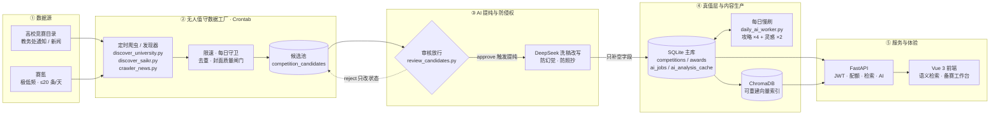

<div align="center">

# KuAo · 库奥

**全自动数据工厂 × AI 备赛智库**

底层数据无人值守地持续进化，上层备赛有据可循、可检索、可复用。

[](https://vuejs.org/)
[](https://fastapi.tiangolo.com/)
[](https://www.sqlite.org/)
[](https://www.trychroma.com/)
[](https://www.deepseek.com/)
[](https://www.python.org/)
[](#-自动化运维)

[项目简介](#-项目简介) · [核心功能亮点](#-核心功能亮点) · [技术栈与架构](#-技术栈与架构) · [快速启动](#-快速启动指南) · [自动化运维](#-自动化运维) · [工程化质量](#-工程化与质量保证)

</div>

---

## 🎯 项目简介

**KuAo（库奥）= 全自动数据工厂 + AI 备赛智库。**

它不是一份静态的赛事清单，而是一套会自己生长的竞赛知识基础设施：

- **底层：无人值守的数据工厂。** Crontab 每天唤醒发现器与爬虫，从高校竞赛目录、教务处通知、赛事新闻与赛氪极低频增量中采集信息；新数据先进入候选池，放行后由 AI 提纯、洗稿与防幻觉校验回写 SQLite 主库。采集、去重、字段抽取、每日慢刷、攻略生成与备份都在无人值守状态下自动推进，人只处理最后一道可审计的候选闸门。
- **上层：可对话的 AI 备赛智库。** 基于真实赛事与获奖作品数据，提供自然语言语义检索、多轮对话备赛计划、单作品深度解析、赛事共性分析以及按赛事隔离的选题灵感。

```text
高校目录 / 通知 / 新闻 / 赛氪
        ↓  Crontab 定时发现与抓取
   候选池 competition_candidates
        ↓  AI 提纯洗稿 · 防幻觉 · 防照抄
   SQLite 主库 competitions / awards
        ↓  FastAPI + ChromaDB
Vue 3 前端 · 语义检索 / 备赛工作台
```

围绕真实备赛流程，平台把四件事连成一条工作流：

- **找得到**：用自然语言描述需求，系统完成语义召回与结构化重排，而不是要求关键词完全匹配；
- **备得清**：AI 教练先追问背景，再生成可执行、可增量修改的备赛计划；
- **学得透**：从历年获奖作品中拆解技术亮点、评审偏好与可复用套路；
- **想得出**：按赛事聚合洞察与选题灵感，把“不知道做什么”变成“知道从哪开始”。

> **数据原则**：发现脚本只写候选池，绝不直接改主库；原文不直接入库，AI 无依据时一律 `NULL` 或写「未公布」；补全只补空字段，不覆盖人工值。候选放行是最后一道可审计闸门——它不是自动化缺口，而是防止脏数据污染智库的安全阀。

---

## ✨ 核心功能亮点

### 01 · AI 智能语义检索

告别“关键词必须完全匹配”的检索方式。用户可以直接输入：

> “我想找寒假能准备的算法赛”
>
> “有没有适合计算机专业、对新手友好的创新创业比赛？”

系统会完成 **查询向量化 → 获奖作品语义召回 → 竞赛级聚合 → 结构化重排**，返回最相关的赛事结果。

- **L1 向量召回**：基于 ChromaDB cosine 相似度进行多路召回，并读取 SQLite 真值做候选过滤；
- **L2 结构化重排**：回到 SQLite 读取作品与竞赛真值，做硬过滤与软加权，已被删除或未审核的内容直接丢弃；
- **竞赛级聚合**：同一赛事的多件命中作品合并计分，避免结果碎片化；
- **优雅降级**：向量库或 Embedding 服务异常时，自动回退关键词检索，页面不白屏。

### 02 · 备赛工作台：从对话到计划，再到作品拆解

不是“一次性丢给模型一段话”，而是模拟真实教练的渐进式工作台。

**多轮对话生成计划**

| 阶段 | 行为 | 返回状态 |
| --- | --- | --- |
| 信息收集 | 背景不足时先反问关键信息 | `ask` |
| 计划生成 | 信息足够后输出完整 Markdown 备赛计划 | `plan` |
| 增量修改 | 在既有计划上继续对话并整合修改 | `refine` |

- 后端自动注入数据库中的真实赛事信息（名称、类别、级别、报名窗口、官网、简介），降低模型编造赛制的概率；
- 支持多轮历史拼接、按赛事隔离的计划恢复与增量修订；
- **单作品深度解析**：作品概览、技术亮点、获奖要素、可借鉴之处、潜在不足、模仿路径；
- **赛事共性分析**：横向对比多件获奖作品，提炼选题共性、技术套路、创新模式与“获奖公式”；
- **灵感工作台**：按赛事隔离沉淀经验、趋势、差距与选题灵感，支持收藏为个人选题池；
- 输出统一经过 Markdown 安全渲染，兼顾可读性与 XSS 防护。

### 03 · AI 分析缓存：把重复推理变成数据库命中

围绕“获奖作品”的单作品解析与赛事共性分析，都带有数据库级缓存，而不是进程内临时缓存。

- 分析结果持久化到 SQLite 的 `ai_analysis_cache`，服务重启后仍然有效；
- 以实际送入模型的 prompt 计算 **SHA-256 指纹**，赛事或作品数据变化时缓存自动失效；
- 同一作品 / 同一赛事再次访问可直接命中缓存，**跳过重复的大模型调用**；
- 缓存读写异常自动降级为直接调用模型，缓存故障不影响接口可用性；
- 攻略生成同样带输入指纹与幂等控制，同一份输入不会反复消耗 token；
- 前端备赛计划按「用户 + 赛事」隔离保存在本地，刷新可恢复，退出登录即清理，避免账号串数据。

### 04 · 全自动数据管线

底层数据源由定时任务持续巡检，不依赖人工导入：

- **高校目录发现**：解析全国普通高校学科竞赛排行榜（84 项）目录页，自动配对赛事名称与官网，归一化去重后写入候选池；支持文本行、表格、裸域名等多种页面形态。
- **赛氪极低频抓取**：每日最多 2 页 / 20 条，请求间隔 3–5 秒，自动跳过报名结束超过 400 天的往年届次，并通过每日守卫防止重复执行。
- **新闻与通知采集**：支持列表页批量抓取、自动翻页、正文抽取与获奖信息识别；按 `source_url` 查重，`content_hash` 唯一索引兜底。
- **统一补全管线**：`pipeline_update.py` 融合赛氪详情、封面质量闸门、报名月份与官网通知页抽取，默认只读预检，`--apply` 才写库。
- **封面质量闸门**：只保存图片 URL，不下载落盘；校验 HTTP 状态、Content-Type、最小宽高与宽高比，banner 宽高比超过 2.6 一律拒收，无图交给前端渐变兜底。

### 05 · AI 提纯与防侵权（护城河）

这是数据工厂最不能被绕过的一层，也是平台长期、稳定生产可信内容的基础。

- **候选池防污染**：发现脚本只能写 `competition_candidates`。审核 `approve` 时才在同一事务写入主表，并重新执行封面质量检查与同名查重；`reject` 只改状态，不碰主库。
- **大模型洗稿改写**：赛氪原始正文**绝不直接入库**。提纯时每个赛事只调用一次大模型，将正文改写为「1. 短句」列表，每条 ≤ 50 字、最多 8 条；与原文字面连续重合 ≥ 40 字即视为照抄，该字段保留 `NULL`，不回落原文、不编造。
- **防幻觉时间红线**：所有抽取字段必须能在原文找到依据，无依据一律 `NULL`；明确区分「比赛时间」与「报名 / 作品提交截止」，避免把报名节点误写成比赛时间。
- **只补空，不覆盖**：采集与提纯链路统一逐字段 `IS NULL` 写入，人工录入或历史值优先，避免平台口径覆盖官方口径。
- **失败即留空**：AI 超时、返回不合法、抽不到依据时保留空值，宁可缺字段，也不制造看似完整的假数据。

### 06 · 定时慢刷与自动化运维

平台不追求“抓得最多”，而是让数据在可控成本下稳定生长。

- **按需生成全流程攻略**：详情页「✨ 生成 AI 攻略」按钮，登录后异步生成。接口幂等，支持 `202 / 409 / 429` 状态区分、15 分钟僵尸任务回收与失败冷却。
- **每日 Cron 慢刷**：`daily_ai_worker.py` 每天最多生成 4 篇攻略 + 2 条灵感，带 token 预算熔断、3 天失败冷却与写前自动备份。
- **预算熔断**：单次慢刷默认 `--budget-tokens 300000`，达到上限立即停止，不把定时任务变成账单黑洞。
- **互斥执行**：所有写库与生成任务统一使用 `flock -n`，备份、发现、AI 生成不重叠。
- **结构化攻略内容**：结合报名 / 比赛月份、官网、获奖作品生成分阶段备赛路线；缺少确定信息时明确写「未公布」，不虚构日期与赛制。

### 07 · 前端体验与安全边界

- **无图卡片兜底**：真实封面永远优先；封面缺失或加载失败时，按赛事名称哈希生成稳定渐变色 + AI 提取的 2 字赛事简称（如「计设」「数模」，无简称时回退名称首字），深浅色主题自动适配，布局尺寸不变。
- **详情页结构化排版**：顶部速览卡 + 中部栅格卡片（时间安排、赛事简介、参赛对象、内容范围、考试安排），攻略以安全 Markdown 渲染；无攻略时保留空壳与生成按钮。
- **多主题与响应式**：官方风、极简风、科技蓝三套主题，首屏防闪白，移动端与桌面端一致可用。
- **JWT 鉴权与 AI 配额**：密码使用 bcrypt 加盐哈希；JWT Secret 启动强校验；AI 生成按用户日配额原子扣减，超额返回 `429`。
- **会话与缓存隔离**：`401` 后清理本地凭证与用户本地数据；备赛计划缓存按用户 ID 分区，避免共享设备上读到上一账号的内容。

---

## 🛠️ 技术栈与架构

### 技术栈

| 层级 | 技术 | 职责 |
| --- | --- | --- |
| **前端** | Vue 3（Composition API） | 页面与交互状态管理 |
| | Vite 5 | 开发服务器、构建与 `/api` 代理 |
| | Tailwind CSS 3.4 | 原子化样式、三套主题与暗黑模式 |
| | Vue Router 4 / Axios | 路由守卫、请求封装、Token 注入与 401/429 处理 |
| | marked + DOMPurify | Markdown 渲染与 XSS 清洗 |
| **后端** | FastAPI + Uvicorn | REST API、依赖注入、OpenAPI 文档 |
| | Pydantic 2 | 请求 / 响应模型与边界校验 |
| | PyJWT + bcrypt | JWT 鉴权与密码哈希 |
| **数据** | SQLite（WAL） | 业务真值库：赛事、获奖、候选、任务、配额、AI 分析缓存 |
| | ChromaDB | 获奖作品向量索引，可从 SQLite 重建 |
| | 云端 Embedding API | 默认 `bge-m3`，轻量服务器无需本地推理 |
| **AI / 检索** | DeepSeek Chat API | 信息抽取、洗稿、攻略、灵感与作品解析 |
| | json_repair | 大模型 JSON 输出容错修复 |
| | L1 向量召回 + L2 结构化重排 | 语义检索与 SQLite 真值过滤 |
| **采集 / 提纯** | requests + BeautifulSoup4 + lxml | 静态页抓取、正文解析与字段抽取 |
| | LLM 洗稿 + 重合度校验 | 防止原文直出与版权风险 |
| **调度 / 运维** | Crontab | 每日发现、AI 慢刷、补全、备份与清理 |
| | flock（util-linux） | 定时任务互斥，防止写入重叠 |
| | systemd + Nginx | FastAPI 常驻、静态托管与 `/api` 反向代理 |
| | SQLite Backup API | WAL 安全在线备份与完整性校验 |

### 整体架构



> 一次完整的数据流向：**数据源（高校 / 赛氪）→ 定时爬虫 → 候选池 → AI 提纯洗稿 → SQLite 主库 → FastAPI / Vue 前端**。候选审核是提纯链路的放行闸门；AI 生成与每日慢刷只消费主库真值，再把攻略、灵感与缓存写回主库。

### 关键架构决策

#### 1. SQLite 是真值源，ChromaDB 只是可重建索引

- 所有赛事、作品、用户、配额与缓存以 SQLite 为准；
- Chroma 中的 `award:{id}` 向量与 metadata 可从 SQLite 全量重建；
- 检索采用 **L1 向量召回 + L2 SQLite 结构化重排**，命中结果若已删除或未审核会被丢弃；
- 即使向量索引损坏，也不会影响业务数据正确性。

#### 2. 为轻量云服务器而生的云端 Embedding

- 项目不加载本地 `sentence-transformers` / BGE 权重，改为调用 OpenAI 兼容的云端 Embedding API；
- 显著降低常驻内存与镜像体积，适合 1C2G / 2C4G 级轻量服务器；
- 批量分批、向量归一化、指数退避重试，兼容 429 / 5xx / 网络抖动；
- Embedding 调用失败不会写入 mock 向量污染索引，仅在显式离线调试模式下使用 mock。

#### 3. 数据库级 AI 缓存与生成幂等

- 以 `(target_type, target_id)` 定位缓存对象，以 prompt 的 SHA-256 指纹判断是否失效；
- 缓存命中直接返回，缓存异常自动降级，不让“加速手段”变成故障点；
- 攻略生成带 `guide_input_hash` 幂等控制，重复请求不会重复生成；
- 前端计划缓存按「用户 + 赛事」隔离，隐私模式或配额满时静默降级。

#### 4. SQLite 并发友好配置

- 统一连接入口，所有业务函数通过上下文管理器获取连接；
- 开启 `journal_mode=WAL`，读写不互相阻塞；
- 设置 `busy_timeout=10000`，写锁竞争时等待而非立即报错；
- 定时任务统一 `flock -n`，从调度层再加一道互斥保险。

---

## 📂 项目结构

> 仅列出核心模块，完整清单见 [交接文档](backend/CRAWLER_HANDOVER.md)。

```text
KuAo-Platform/
├── backend/
│   ├── main.py                    # FastAPI 入口：CORS、路由、启动初始化
│   ├── config.py / security.py    # 集中配置、JWT 与配额
│   ├── db.py / schema_v2.sql      # SQLite 数据层、建表与幂等迁移
│   ├── llm.py / embedder.py       # 大模型 JSON 抽取、云端向量化
│   ├── retriever.py               # Chroma 索引 + L1 召回 + L2 重排
│   │
│   ├── crawler_news.py            # 新闻 / 通知采集：获奖抽取、翻页、去重
│   ├── crawler_competitions.py    # 赛事详情采集：正文、封面、字段抽取
│   ├── pipeline_update.py         # 赛氪 + 通知页统一预检 / 补全管线
│   ├── enrich_saikr_details.py    # AI 提纯 + 洗稿 + 照抄检测，backfill / daily 双模式
│   ├── batch_update_competitions.py # 存量赛事批量补全（只填空）
│   │
│   ├── discover_common.py         # 发现公共层：目标库保护、备份、去重入库
│   ├── discover_university.py     # 高校 84 项目录发现
│   ├── discover_saikr.py          # 赛氪每日增量发现（≤20 条/天）
│   ├── review_candidates.py       # 候选审核 CLI：list / approve / reject
│   │
│   ├── ai_content.py              # Prompt 与生成核心（攻略 / 灵感）
│   ├── ai_jobs_runner.py          # ai_jobs 编排：线程池、预算、冷却
│   ├── daily_ai_worker.py         # 每日慢刷 worker（Cron 入口）
│   ├── generate_guides.py         # 单条 / 批量攻略 CLI（兼容入口）
│   ├── analyzer.py                # 赛事洞察与选题灵感
│   ├── cleanup_orphan_ai.py       # 孤儿 insights / ideas 清理
│   │
│   ├── backup_db.py               # WAL 安全在线备份 + 完整性校验
│   ├── migrate_production.py      # 生产库体检 / 迁移
│   ├── merge_test_competitions.py # 测试库 → 生产库合并
│   ├── verify_crawl.py            # 采集结果读回校验
│   │
│   ├── routers/                   # auth / competitions / preparations / ai / feedback
│   ├── models/schemas.py          # Pydantic 响应模型
│   ├── workspace/                 # 采集报告、预检 JSON、验证截图（gitignored）
│   ├── backups/                   # 生产库定时备份
│   └── CRAWLER_HANDOVER.md        # 架构与运维交接文档（接手必读）
│
├── frontend/
│   ├── src/views/                 # 首页、赛事列表 / 详情、备赛工作台、个人中心
│   ├── src/components/            # 卡片、Header、登录弹窗、Toast 等
│   ├── src/services/              # API、鉴权、计划缓存、Markdown 渲染
│   ├── src/composables/           # 主题、登录弹窗、全局 Toast
│   ├── src/utils/coverFallback.js # 无图封面渐变色兜底
│   └── src/router/                # 路由表与鉴权守卫
│
├── .gitignore
└── README.md
```

**后端模块速查**

| 类别 | 模块 |
| --- | --- |
| 采集器 | `crawler_news.py`、`crawler_competitions.py`、`pipeline_update.py` |
| 发现器 | `discover_university.py`、`discover_saikr.py` |
| 审核 / 提纯 | `review_candidates.py`、`enrich_saikr_details.py` |
| AI Worker | `ai_content.py`、`short_names.py`、`ai_jobs_runner.py`、`daily_ai_worker.py` |
| 检索 / 缓存 | `retriever.py`、`ai_analysis_cache`、`planCache.js` |
| CLI 工具 | `generate_guides.py`、`generate_short_names.py`、`batch_update_competitions.py`、`backup_db.py`、`migrate_production.py`、`verify_crawl.py` |

---

## 🚀 快速启动指南

### 环境要求

| 依赖 | 版本建议 |
| --- | --- |
| Python | 3.10+（云端为 3.11） |
| Node.js | 18+ |
| npm | 9+ |
| 网络 | 可访问 DeepSeek 与 Embedding API |

### 1. 安装后端依赖

```bash
cd backend

python -m venv venv
# Windows PowerShell
.\venv\Scripts\Activate.ps1
# macOS / Linux
# source venv/bin/activate

python -m pip install -r requirements.txt
```

### 2. 配置 `.env`

在 `backend/` 下创建 `.env`（不要提交到版本库）：

```dotenv
# ---------- 大模型 ----------
DEEPSEEK_API_KEY=sk-your-deepseek-api-key
DEEPSEEK_BASE_URL=https://api.deepseek.com
DEEPSEEK_MODEL=deepseek-chat

# ---------- 云端 Embedding ----------
EMBEDDING_API_KEY=sk-your-embedding-api-key
EMBEDDING_BASE_URL=https://api.siliconflow.cn/v1
EMBEDDING_MODEL=bge-m3

# ---------- 鉴权 ----------
# 至少 32 位；未配置或过短时后端会拒绝启动
JWT_SECRET_KEY=replace-with-a-random-string-at-least-32-chars
JWT_EXPIRE_MINUTES=1440

# ---------- CORS ----------
CORS_ALLOW_ORIGINS=http://localhost:5173,http://127.0.0.1:5173

# ---------- AI 配额 ----------
AI_DAILY_QUOTA=30
AI_GUIDE_DAILY_LIMIT=8
AI_GUIDE_QUEUE_MAX=5
AI_GUIDE_FAIL_COOLDOWN_MIN=30
```

生成随机 JWT 密钥：

```bash
python -c "import secrets; print(secrets.token_urlsafe(48))"
```

> `JWT_SECRET_KEY` 未配置、使用默认开发密钥或长度不足 32 位时，后端会主动拒绝启动。这是有意的 fail-fast 安全设计。

### 3. 初始化数据库

后端启动时会自动执行幂等建表与补列，首次运行即可生成 `backend/competitions.db`。若使用历史数据库，建议先体检再迁移：

```bash
python migrate_production.py            # 只读体检
python migrate_production.py --apply    # 备份后补列
```

本地调试请优先使用测试库，避免污染生产数据：

```bash
# 后端服务未写入时可直接复制
cp competitions.db test_crawl.db          # macOS / Linux
# Copy-Item .\competitions.db .\test_crawl.db   # Windows PowerShell
```

### 4. 启动后端

```bash
# 在 backend/ 目录执行
python -m uvicorn main:app --reload --host 0.0.0.0 --port 8000
```

- 健康检查：<http://127.0.0.1:8000/api/health>
- Swagger：<http://127.0.0.1:8000/docs>

### 5. 启动前端

另开终端：

```bash
cd frontend
npm install
npm run dev
```

访问 <http://localhost:5173>。Vite 默认将 `/api` 代理到 `http://127.0.0.1:8000`；如需修改，在 `frontend/.env` 中设置 `VITE_API_BASE_URL`。

### 6. 生产构建

```bash
cd frontend
npm run build
```

产物输出到 `frontend/dist/`。Nginx 需配置 SPA History fallback，并将 `/api` 反向代理到 FastAPI。

### 常用地址

| 服务 | 地址 |
| --- | --- |
| 前端开发服务器 | <http://localhost:5173> |
| 后端 API | <http://127.0.0.1:8000> |
| Swagger | <http://127.0.0.1:8000/docs> |
| 健康检查 | <http://127.0.0.1:8000/api/health> |

---

## ⚙️ 自动化运维

生产环境部署在 Linux 服务器：FastAPI 由 `systemd` 常驻，Nginx 托管前端并反代 `/api`，Crontab 驱动数据采集、AI 慢刷、备份与清理。

### 生产调度表（Asia/Shanghai）

> 下表是系统“活着”的证据：每天都有数据发现、AI 慢刷与备份在固定时间发生。实际以服务器 `crontab -l` 为准。

| 时间 | 频率 | 任务 | 写入 / 产物 | 保护机制 |
| --- | --- | --- | --- | --- |
| 02:30 | 每天 | 生产库在线备份 | `backups/`，保留 30 天 | WAL 安全 + `integrity_check` + `flock` |
| 04:10 | 每天 | 赛氪增量发现 | 只写 `competition_candidates` | 每日守卫 + 2 页 / 20 条上限 + `flock` |
| 04:40 | 每天 | AI 慢刷 4 篇攻略 + 2 条灵感 | 攻略、`insights`、`ideas`、`ai_jobs` | 300k token 预算熔断 + 3 天失败冷却 + `flock` |
| 05:20 | 每周日 | 存量赛事补全（限 20 条） | 只补空字段 | 写前备份 + `flock` |
| 05:40 | 每天 | 清理 7 天前日志 | 仅 `logs/` | 路径限定 |
| 05:50 | 每周日 | 清理 30 天前本地备份 | 仅 `backups/` | 路径限定 |

**执行链路不可颠倒：**

```text
02:30 备份 → 04:10 发现（只写候选） → 04:40 AI 慢刷（消费当天数据）
→ 周日 05:20 存量补全 → 05:40 / 05:50 清理
```

> 新闻采集当前为**预留任务**：待确定 `LIST_URL` 后，按周一 / 周四 03:00 单独挂载，写入前同样需要 `--allow-production` 与备份保护。

### 运维约定

- **统一时区**：Debian / Ubuntu 的 cron 不支持 `CRON_TZ`，必须将系统时区设为 `Asia/Shanghai`。
- **互斥执行**：所有任务使用 `flock -n`，避免备份、写库与 AI 生成重叠。
- **生产写库三件套**：`--apply` + `--allow-production` + 写前自动备份，缺一不可；所有脚本默认 dry-run。
- **Cron 不带 `--force`**：绕过每日守卫与幂等闸门会破坏限速与去重承诺。
- **限速红线**：赛氪 3–5 秒 / 每日 ≤20 条，补全 5–10 秒，新闻 2–5 秒，不得为提速调小。
- **候选审核**：`review_candidates.py --list/--approve/--reject`；服务、广告、辅助报名类直接拒绝。
- **图片策略**：只保存图片 URL，不下载落盘；宽高比 > 2.6 的 banner 一律拒收，无图交给前端渐变兜底。
- **成本边界**：AI 慢刷有 token 预算熔断，用户侧有每日配额，慢刷与配额双重兜底。

### 活体检查

```bash
cd /root/KuAo/backend

# 1) 定时器是否存在
crontab -l | grep -E 'discover_saikr|daily_ai_worker|backup_db'

# 2) 今天是否跑过、消耗了多少 token
tail -n 50 logs/ai-$(date +%F).log

# 3) 候选池是否在持续增长
./venv/bin/python -c "import db; print(db.candidate_stats('competitions.db'))"

# 4) 服务是否健康
systemctl is-active kuao-backend
curl -fsS http://127.0.0.1:8000/api/health
```

### 故障排查

先看 `ai_jobs` 状态与 `logs/`，再核对 `systemctl status kuao-backend` 与健康检查。若出现 `database is locked`，优先检查是否有两个写任务重叠、`flock` 是否生效；若 AI 任务长期停在 `running`，等待 15 分钟租约回收后重试，不要直接手改数据库状态。

---

## 🛡️ 工程化与质量保证

> 交付前，前后端分别完成了全链路 Code Review，并针对核心业务路径与边界条件设计了可执行的测试用例。审查报告与用例清单与代码同仓维护，作为持续回归资产。

### 全链路 Code Review

| 范围 | 审查重点 | 交付文档 |
| --- | --- | --- |
| **后端** | 鉴权、CORS、密钥管理、SQL 注入、SQLite 并发、LLM 超时重试、配额、缓存、依赖可部署性、错误处理 | [后端 Code Review](backend/CODE_REVIEW_BACKEND.md) |
| **前端** | API 地址与部署、密钥泄露、401 会话边界、竞态与状态隔离、XSS、本地缓存、主题一致性、可访问性 | [前端 Code Review](frontend/CODE_REVIEW_FRONTEND.md) |

### 边界测试

| 层级 | 交付物 | 规模 | 覆盖重点 |
| --- | --- | --- | --- |
| 后端 | [TEST_CASES_BACKEND.md](backend/TEST_CASES_BACKEND.md) + [test_api_boundaries.py](backend/test_api_boundaries.py) | 74 个测试方法 | 鉴权、配额、竞赛、灵感、计划、分析、检索、备赛、LLM 重试、DB 事务、请求体安全 |
| 前端 | [TEST_CASES_FRONTEND.md](frontend/TEST_CASES_FRONTEND.md) | 156 条用例（P0 57 / P1 69 / P2 30） | 登录态、路由守卫、检索竞态、筛选、工作台切赛事、缓存、主题、可访问性、性能、安全 |

边界用例重点覆盖：空值与类型错误、数值与长度边界、并发抢配额与 SQLite 锁竞争、SQL 注入 / XSS / 伪造 JWT、LLM 超时与 429、Embedding 不可用、脏 localStorage、切赛事竞态与主题闪白。

### P0 / P1 风险修复闭环

| 风险项 | 修复措施 | 落点 |
| --- | --- | --- |
| API 密钥泄露 | 前端不持有模型密钥，密钥统一收敛到后端环境变量；JWT Secret 启动强校验 | `config.py`、`.gitignore` |
| CORS 配置不当 | 改为 `CORS_ALLOW_ORIGINS` 白名单，检测到 `*` 直接拒绝启动 | `main.py` |
| SQLite 并发锁 | WAL + `busy_timeout=10000`，连接统一上下文管理，提交 / 回滚 / 关闭成对 | `db.py` |
| 大模型超时与重试叠加 | 关闭 SDK 自带重试，连接 5s / 读取 45s；应用层有界指数退避 | `llm.py` |
| 登录态串号 | 计划缓存按用户 ID 分区，退出 / 401 清理本地数据，旧版无归属缓存直接丢弃 | `planCache.js`、`api.js` |

### 工程细节

- **配置集中化**：`config.py` 统一读取与容错转换，业务模块不散落 `os.getenv`；
- **依赖锁定**：`requirements.txt` 锁定 FastAPI、OpenAI、ChromaDB、PyJWT 等运行时版本；
- **请求治理**：Axios 统一注入 Token、归一化错误、处理 401/429；
- **竞态防护**：检索、赛事详情、作品解析等异步请求保留请求上下文校验，过期响应不覆盖新状态；
- **降级策略**：`localStorage` 不可用、缓存损坏、向量检索失败、LLM 调用失败均有兜底路径；
- **安全渲染**：Markdown 统一 `marked → DOMPurify.sanitize`，绝不把模型输出直接当作可信 HTML。

---

## 📌 生产部署提示

- **密钥管理**：生产环境不要提交 `.env`，使用平台 Secret / 环境变量注入；定期轮换 DeepSeek 与 Embedding Key。
- **CORS**：将 `CORS_ALLOW_ORIGINS` 设置为真实前端域名，禁止使用 `*`。
- **反向代理**：推荐 Nginx 同源代理 `/api`，并配置 SPA History fallback。
- **SQLite 场景**：建议单实例部署；若需要多实例或多 worker，请改用 PostgreSQL 等支持并发写的数据库。
- **AI 成本**：通过 `AI_DAILY_QUOTA` 控制单用户额度，通过慢刷预算控制系统成本，并在网关层补充 IP 级限流与请求体大小限制。
- **内容边界**：AI 生成内容仅作备赛参考，赛事时间、报名要求与评审规则请以官方通知为准。

---

## 📚 文档索引

| 文档 | 内容 |
| --- | --- |
| [CRAWLER_HANDOVER.md](backend/CRAWLER_HANDOVER.md) | 爬虫、AI 链路、审核机制与开发红线（接手必读） |
| [CLOUD_DEPLOYMENT_GUIDE.md](backend/CLOUD_DEPLOYMENT_GUIDE.md) | 云端部署、数据库迁移、systemd / Nginx / crontab |
| [AI_AUTOMATION_PLAN.md](backend/AI_AUTOMATION_PLAN.md) | AI 生成与自动化方案设计 |
| [CODE_REVIEW_BACKEND.md](backend/CODE_REVIEW_BACKEND.md) | 后端 Code Review 报告 |
| [CODE_REVIEW_FRONTEND.md](frontend/CODE_REVIEW_FRONTEND.md) | 前端 Code Review 报告 |
| [TEST_CASES_BACKEND.md](backend/TEST_CASES_BACKEND.md) | 后端边界测试用例 |
| [TEST_CASES_FRONTEND.md](frontend/TEST_CASES_FRONTEND.md) | 前端测试用例清单 |

---

<div align="center">

**KuAo · 库奥**

底层自动生长，上层有据可循。

</div>
