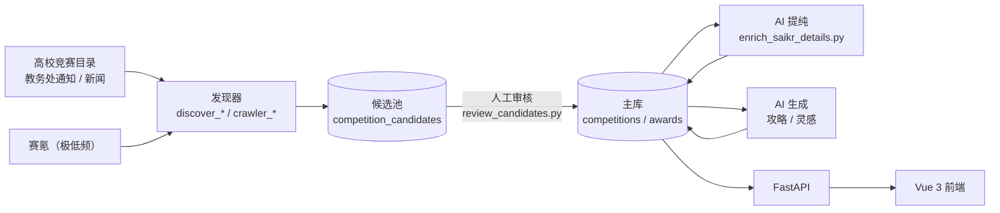

<div align="center">

# KuAo · 库奥

**智能学科竞赛备赛平台**

从「发现赛事」到「生成攻略」，把分散的竞赛信息沉淀为可检索、可审核、可复用的备赛知识库。

[](https://vuejs.org/)
[](https://fastapi.tiangolo.com/)
[](https://www.sqlite.org/)
[](https://www.trychroma.com/)
[](https://www.deepseek.com/)
[](https://www.python.org/)

[项目简介](#-项目简介) · [核心特性](#-核心特性) · [技术栈](#-技术栈) · [目录结构](#-目录结构) · [快速启动](#-快速启动) · [自动化运维](#-自动化运维)

</div>

---

## 🎯 项目简介

**KuAo（库奥）** 是面向大学生的智能学科竞赛备赛平台，基于 **Vue 3 + FastAPI + SQLite + ChromaDB** 构建。平台围绕真实备赛流程，提供赛事检索、AI 备赛计划、获奖作品解析、赛事洞察与选题灵感，并已打通 **数据采集 → 候选审核 → AI 提纯 → 内容生成** 的全自动内容生产链路。



> **数据原则**：所有新赛事先进入候选池，人工审核后才写入主库；所有 AI 生成内容只依据库内真实字段，缺依据时明确留空或写「未公布」。

---

## ✨ 核心特性

### 01 · 全自动数据采集

- **高校目录发现**：解析全国普通高校学科竞赛排行榜（84 项）目录页，自动配对赛事名称与官网，归一化去重后写入候选池；支持文本行、表格、裸域名等多种页面形态。
- **赛氪极低频抓取**：每日最多 2 页 / 20 条，请求间隔 3–5 秒，自动跳过报名结束超过 400 天的往年届次，并通过每日守卫防止重复执行。
- **新闻与通知采集**：支持列表页批量抓取、自动翻页、正文抽取与获奖信息识别；按 `source_url` 查重，`content_hash` 唯一索引兜底。
- **统一补全管线**：`pipeline_update.py` 融合赛氪详情、封面质量闸门、报名月份与官网通知页抽取，默认只读预检，`--apply` 才写库。

### 02 · AI 智能提纯（防幻觉 · 防侵权 · 防污染）

- **防幻觉 Prompt**：所有抽取字段必须能在原文找到依据，无依据一律 `NULL`；明确区分「比赛时间」与「报名 / 作品提交截止」。
- **洗稿过滤**：赛氪原始正文**绝不直接入库**。详情提纯时，每个赛事只调用一次大模型，将内容改写为「1. 短句」列表（每条 ≤ 50 字、≤ 8 条）；与原文字面重合 ≥ 40 字视为照抄，该字段保留 `NULL`，不回落原文、不编造。
- **候选池防污染**：发现脚本只能写 `competition_candidates`。人工审核 `approve` 时才在同一事务写入主表，并重新执行封面质量检查、同名查重，审核通过后自动补全详情字段。
- **只补空，不覆盖**：采集与提纯链路统一逐字段 `IS NULL` 写入；人工录入或历史值优先，避免平台口径覆盖官方口径。

### 03 · AI 内容生成

- **按需生成全流程攻略**：详情页「✨ 生成 AI 攻略」按钮，登录后异步生成。接口幂等，支持 `202 / 409 / 429` 状态区分、15 分钟僵尸任务回收与失败冷却。
- **每日慢刷备赛灵感**：`daily_ai_worker.py` 每天最多生成 4 篇攻略 + 2 条灵感，带 token 预算熔断、3 天失败冷却与写前自动备份。
- **结构化攻略内容**：结合报名/比赛月份、官网、获奖作品生成分阶段备赛路线；缺少确定信息时明确写「未公布」，不虚构日期与赛制。
- **灵感资产**：按赛事隔离生成经验、趋势、差距与选题灵感，支持收藏沉淀为个人选题池。

### 04 · 优雅的前端交互

- **无图卡片兜底**：封面缺失或加载失败时，按赛事名称哈希生成稳定渐变色 + 赛事首字，深浅色主题自动适配，布局尺寸不变。
- **详情页结构化排版**：顶部速览卡 + 中部栅格卡片（时间安排、赛事简介、参赛对象、内容范围、考试安排），攻略以安全 Markdown 渲染；无攻略时保留空壳与生成按钮。
- **多主题与响应式**：官方风、极简风、科技蓝三套主题，首屏防闪白，移动端与桌面端一致可用。
- **完整备赛工作台**：多轮对话生成/修订备赛计划，单作品深度解析与赛事共性分析，结果落库缓存以控制模型成本。

---

## 🛠️ 技术栈

| 层级 | 技术 | 说明 |
| --- | --- | --- |
| **前端** | Vue 3（Composition API） | 页面与交互状态 |
| | Vite 5 | 开发服务器、构建与 `/api` 代理 |
| | Tailwind CSS 3.4 | 原子化样式、主题与暗黑模式 |
| | Vue Router 4 / Axios | 路由守卫、请求封装与 Token 注入 |
| | marked + DOMPurify | Markdown 渲染与 XSS 清洗 |
| **后端** | FastAPI + Uvicorn | REST API、依赖注入、OpenAPI |
| | Pydantic 2 | 请求/响应模型与边界校验 |
| | PyJWT + bcrypt | JWT 鉴权与密码哈希 |
| **数据** | SQLite（WAL） | 业务真值库：赛事、获奖、候选、任务、配额 |
| | ChromaDB | 获奖作品向量索引，可从 SQLite 重建 |
| | 云端 Embedding API | 默认 `bge-m3`，轻量服务器无需本地推理 |
| **AI** | DeepSeek Chat API | 信息抽取、攻略、灵感与作品解析 |
| | json_repair | 大模型 JSON 输出容错修复 |
| **采集** | requests + BeautifulSoup4 + lxml | 静态页抓取与正文解析 |
| **运维** | systemd + Nginx + Crontab + flock | 常驻服务、反向代理、定时任务链 |

---

## 📂 目录结构

> 仅列出核心模块，完整清单见 [交接文档](backend/CRAWLER_HANDOVER.md)。

```text
KuAo-Platform/
├── backend/
│   ├── main.py                    # FastAPI 入口：CORS、路由、启动初始化
│   ├── config.py / security.py    # 集中配置、JWT 与配额
│   ├── db.py / schema_v2.sql      # SQLite 数据层、建表与幂等迁移
│   ├── llm.py / embedder.py       # 大模型 JSON 抽取、云端向量化
│   ├── retriever.py               # Chroma 索引 + L1 召回 + L2 重排
│   │
│   ├── crawler_news.py            # 新闻/通知采集：获奖抽取、翻页、去重
│   ├── crawler_competitions.py    # 赛事详情采集：正文、封面、字段抽取
│   ├── pipeline_update.py         # 赛氪 + 通知页统一预检/补全管线
│   ├── enrich_saikr_details.py    # 赛氪详情补充：AI 提纯、backfill/daily 双模式
│   ├── batch_update_competitions.py # 存量赛事批量补全（只填空）
│   │
│   ├── discover_common.py         # 发现公共层：目标库保护、备份、去重入库
│   ├── discover_university.py     # 高校 84 项目录发现
│   ├── discover_saikr.py          # 赛氪每日增量发现（≤20 条/天）
│   ├── review_candidates.py       # 候选审核 CLI：list / approve / reject
│   │
│   ├── ai_content.py              # Prompt 与生成核心（攻略/灵感）
│   ├── ai_jobs_runner.py          # ai_jobs 编排：线程池、预算、冷却
│   ├── daily_ai_worker.py         # 每日慢刷 worker（cron 入口）
│   ├── generate_guides.py         # 单条/批量攻略 CLI（兼容入口）
│   ├── analyzer.py                # 赛事洞察与选题灵感
│   ├── cleanup_orphan_ai.py       # 孤儿 insights/ideas 清理
│   │
│   ├── backup_db.py               # WAL 安全在线备份 + 完整性校验
│   ├── migrate_production.py      # 生产库体检 / 迁移
│   ├── merge_test_competitions.py # 测试库 → 生产库合并
│   ├── verify_crawl.py            # 采集结果读回校验
│   │
│   ├── routers/                   # auth / competitions / preparations / ai / feedback
│   ├── models/schemas.py          # Pydantic 响应模型
│   ├── workspace/                 # 采集报告、预检 JSON、验证截图（gitignored）
│   ├── backups/                   # 生产库定时备份
│   └── CRAWLER_HANDOVER.md        # 架构与运维交接文档（接手必读）
│
├── frontend/
│   ├── src/views/                 # 首页、赛事列表/详情、备赛工作台、个人中心
│   ├── src/components/            # 卡片、Header、登录弹窗、Toast 等
│   ├── src/services/              # API、鉴权、计划缓存、Markdown 渲染
│   ├── src/utils/coverFallback.js # 无图封面渐变色兜底
│   └── src/router/                # 路由表与鉴权守卫
│
├── .gitignore
└── README.md
```

**后端模块速查**

| 类别 | 模块 |
| --- | --- |
| 采集器 | `crawler_news.py`、`crawler_competitions.py`、`pipeline_update.py` |
| 发现器 | `discover_university.py`、`discover_saikr.py` |
| 审核 / 提纯 | `review_candidates.py`、`enrich_saikr_details.py` |
| AI Worker | `ai_content.py`、`ai_jobs_runner.py`、`daily_ai_worker.py` |
| CLI 工具 | `generate_guides.py`、`batch_update_competitions.py`、`backup_db.py`、`migrate_production.py`、`verify_crawl.py` |

---

## 🚀 快速启动

### 环境要求

| 依赖 | 版本建议 |
| --- | --- |
| Python | 3.10+（云端为 3.11） |
| Node.js | 18+ |
| npm | 9+ |
| 网络 | 可访问 DeepSeek 与 Embedding API |

### 1. 安装后端依赖

```bash
cd backend

python -m venv venv
# Windows PowerShell
.\venv\Scripts\Activate.ps1
# macOS / Linux
# source venv/bin/activate

python -m pip install -r requirements.txt
```

### 2. 配置 `.env`

在 `backend/` 下创建 `.env`（不要提交到版本库）：

```dotenv
# ---------- 大模型 ----------
DEEPSEEK_API_KEY=sk-your-deepseek-api-key
DEEPSEEK_BASE_URL=https://api.deepseek.com
DEEPSEEK_MODEL=deepseek-chat

# ---------- 云端 Embedding ----------
EMBEDDING_API_KEY=sk-your-embedding-api-key
EMBEDDING_BASE_URL=https://api.siliconflow.cn/v1
EMBEDDING_MODEL=bge-m3

# ---------- 鉴权 ----------
# 至少 32 位；未配置或过短时后端会拒绝启动
JWT_SECRET_KEY=replace-with-a-random-string-at-least-32-chars
JWT_EXPIRE_MINUTES=1440

# ---------- CORS ----------
CORS_ALLOW_ORIGINS=http://localhost:5173,http://127.0.0.1:5173

# ---------- AI 配额 ----------
AI_DAILY_QUOTA=30
AI_GUIDE_DAILY_LIMIT=8
AI_GUIDE_QUEUE_MAX=5
AI_GUIDE_FAIL_COOLDOWN_MIN=30
```

生成随机 JWT 密钥：

```bash
python -c "import secrets; print(secrets.token_urlsafe(48))"
```

### 3. 初始化数据库

后端启动时会自动执行幂等建表与补列，首次运行即可生成 `backend/competitions.db`。若使用历史数据库，建议先体检再迁移：

```bash
python migrate_production.py            # 只读体检
python migrate_production.py --apply    # 备份后补列
```

本地调试请优先使用测试库，避免污染生产数据：

```bash
# 后端服务未写入时可直接复制
cp competitions.db test_crawl.db          # macOS / Linux
# Copy-Item .\competitions.db .\test_crawl.db   # Windows PowerShell
```

### 4. 启动后端

```bash
# 在 backend/ 目录执行
python -m uvicorn main:app --reload --host 0.0.0.0 --port 8000
```

- 健康检查：<http://127.0.0.1:8000/api/health>
- Swagger：<http://127.0.0.1:8000/docs>

### 5. 启动前端

另开终端：

```bash
cd frontend
npm install
npm run dev
```

访问 <http://localhost:5173>。Vite 默认将 `/api` 代理到 `http://127.0.0.1:8000`；如需修改，在 `frontend/.env` 中设置 `VITE_API_BASE_URL`。

### 6. 生产构建

```bash
cd frontend
npm run build
```

产物输出到 `frontend/dist/`。Nginx 需配置 SPA History fallback，并将 `/api` 反向代理到 FastAPI。

---

## ⚙️ 自动化运维

生产环境部署在 Linux 服务器：FastAPI 由 `systemd` 常驻，Nginx 托管前端并反代 `/api`，Crontab 驱动数据采集与 AI 生成链路。

### 定时任务链

| 时间（Asia/Shanghai） | 任务 | 脚本 |
| --- | --- | --- |
| 每天 02:30 | 生产库在线备份（WAL 安全，保留 30 天） | `backup_db.py` |
| 每天 04:10 | 赛氪增量发现，只写候选池 | `discover_saikr.py` |
| 每天 04:40 | AI 慢刷：4 篇攻略 + 2 条灵感，预算熔断 | `daily_ai_worker.py` |
| 每周日 05:20 | 存量赛事补全（限 20 条） | `pipeline_update.py` |
| 每天 05:40 | 清理 7 天前日志 | `find` |
| 每周日 05:50 | 清理 30 天前本地备份 | `find` |

> 顺序不可颠倒：**先备份，再写库**；发现只写候选，AI 消费当天数据；清理最后执行。新闻采集与每日详情补全可按需追加，前者需先确定 `LIST_URL`。

### Crontab 示例

```cron
SHELL=/bin/bash
PATH=/usr/local/bin:/usr/bin:/bin
MAILTO=""

# 0) 每天 02:30 生产库备份
30 2 * * * cd /root/KuAo/backend && flock -n /var/lock/kuao_backup.lock ./venv/bin/python backup_db.py --db competitions.db --backup-dir backups --keep-days 30 --label daily >> logs/backup-$(date +\%F).log 2>&1

# 1) 每天 04:10 新赛事发现（只写候选表）
10 4 * * * cd /root/KuAo/backend && flock -n /var/lock/kuao_saikr.lock ./venv/bin/python discover_saikr.py --db-path competitions.db --apply --allow-production >> logs/discover-$(date +\%F).log 2>&1

# 2) 每天 04:40 AI 慢刷
40 4 * * * cd /root/KuAo/backend && flock -n /var/lock/kuao_ai.lock ./venv/bin/python daily_ai_worker.py --db-path competitions.db --apply --allow-production --limit 4 --idea-limit 2 --budget-tokens 300000 >> logs/ai-$(date +\%F).log 2>&1

# 3) 每周日 05:20 存量补全
20 5 * * 0 cd /root/KuAo/backend && flock -n /var/lock/kuao_pipeline.lock ./venv/bin/python pipeline_update.py --db-path competitions.db --apply --allow-production --limit 20 >> logs/pipeline-$(date +\%F).log 2>&1

# 4) 每天 05:40 日志清理（只清 logs/）
40 5 * * * find /root/KuAo/backend/logs -type f -name '*.log*' -mtime +7 -delete >> /root/KuAo/backend/logs/cleanup.log 2>&1

# 5) 每周日 05:50 备份清理
50 5 * * 0 find /root/KuAo/backend/backups -type f -name 'competitions.db.bak-*' -mtime +30 -delete >> /root/KuAo/backend/logs/cleanup.log 2>&1
```

> 示例按当前部署路径 `/root/KuAo/backend` 编写；如迁移至 `/opt/kuao`，需同步修改 Crontab、systemd 与 Nginx 中的路径。

### 运维约定

- **统一时区**：Debian/Ubuntu 的 cron 不支持 `CRON_TZ`，必须设置系统时区为 `Asia/Shanghai`。
- **互斥执行**：所有任务使用 `flock -n`，避免备份、写库与 AI 生成重叠。
- **生产写库三件套**：`--apply` + `--allow-production` + 写前自动备份，缺一不可；所有脚本默认 dry-run。
- **限速红线**：赛氪 3–5 秒 / 每日 ≤20 条，补全 5–10 秒，新闻 2–5 秒，不得为提速调小。
- **候选审核**：`review_candidates.py --list/--approve/--reject`；服务、广告、辅助报名类直接拒绝。
- **图片策略**：只保存图片 URL，不下载落盘；宽高比 > 2.6 的 banner 一律拒收，无图交给前端渐变兜底。
- **故障排查**：先看 `ai_jobs` 状态与 `logs/`，再核对 `systemctl status kuao-backend` 与健康检查。

---

## 📚 文档索引

| 文档 | 内容 |
| --- | --- |
| [CRAWLER_HANDOVER.md](backend/CRAWLER_HANDOVER.md) | 爬虫、AI 链路、审核机制与开发红线（接手必读） |
| [CLOUD_DEPLOYMENT_GUIDE.md](backend/CLOUD_DEPLOYMENT_GUIDE.md) | 云端部署、数据库迁移、systemd / Nginx / crontab |
| [AI_AUTOMATION_PLAN.md](backend/AI_AUTOMATION_PLAN.md) | AI 生成与自动化方案设计 |
| [CODE_REVIEW_BACKEND.md](backend/CODE_REVIEW_BACKEND.md) | 后端 Code Review 报告 |
| [CODE_REVIEW_FRONTEND.md](frontend/CODE_REVIEW_FRONTEND.md) | 前端 Code Review 报告 |
| [TEST_CASES_BACKEND.md](backend/TEST_CASES_BACKEND.md) | 后端边界测试用例 |
| [TEST_CASES_FRONTEND.md](frontend/TEST_CASES_FRONTEND.md) | 前端测试用例清单 |

---

<div align="center">

**KuAo · 库奥**

让赛事发现自动化，让备赛有据可循。

</div>
